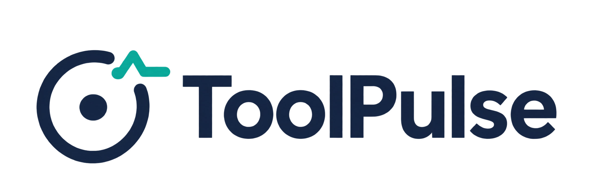
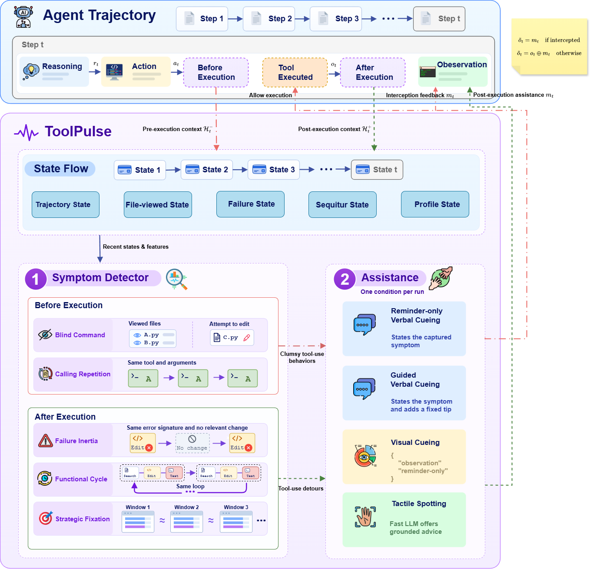
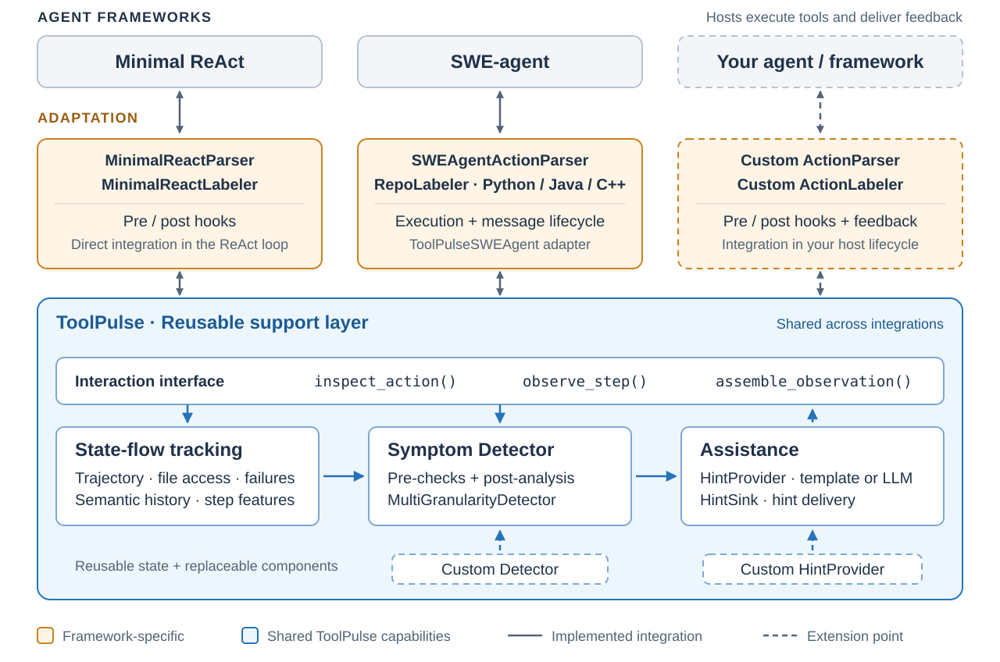

# ToolPulse

<p align="center">
  
</p>

[English](README.md) | [简体中文](README.zh-CN.md)

**State-flow-tracking online tool-use assistance for task-oriented agents.**

ToolPulse is a middleware support layer for autonomous tool use. It tracks an agent's execution context and temporal tool-use patterns across interactions, examining proposed calls before execution and tool feedback before the agent continues. Its evolving state helps identify clumsy tool-use behaviors and tool-use detours in the context of the agent's working rhythm.

When assistance is warranted, ToolPulse provides a cue, offers context-specific guidance, or lets the host intercept an insufficiently grounded call. Like a weightlifting spotter, it lends a hand when needed while the agent remains responsible for carrying the task forward.



## Quick start

Requires **Python 3.10+**. From the repository root:

```bash
python -m pip install -e .
python examples/minimal_react/run.py
```

This runs a complete minimal ReAct loop with two in-memory tools. After installation, the demo needs no API key, model service, network access, Docker, or SWE-agent.

The seven scripted actions demonstrate Blind Command, Failure Inertia, and Calling Repetition, followed by a successful correction. The output includes:

```text
Tool-use notice: You tried to edit note.txt using file before inspecting the file in the current task.
Tool-use notice: You received test_failure error again from check without taking an effective recovery action after the previous error.
Tool-use notice: You called check with exactly the same arguments in 3 consecutive steps.
...
Finished
```

Decisions are scripted for reproducibility; they do not change in response to hints. Tool results come from actual operations on the in-memory files. See the [minimal ReAct example](examples/minimal_react/README.md) for the full walkthrough.

## How it works

### Symptom Detector

The Symptom Detector uses the evolving execution state to identify tool-use symptoms across interactions. It checks proposed calls before execution and analyzes tool feedback after execution, drawing on the action trajectory, file-view history, failure records, and temporal patterns:

```text
Agent proposes a tool call
  → Pre-check using current context
  → Host executes or intercepts the call
  → Post-analysis of executed tool feedback
  → Assistance is added to the next agent input
```

The current detector identifies five symptoms:

| Symptom | Signal |
|---|---|
| Blind Command | Editing a file before inspecting it in the current task |
| Calling Repetition | Consecutive calls with the same action and arguments |
| Failure Inertia | Recurring failures without an intervening recovery signal |
| Functional Cycle | Repeated semantic action sequences |
| Strategic Fixation | Highly similar behavior across consecutive interaction windows |

The framework supplies action syntax and semantics; ToolPulse supplies shared state tracking, detection, and assistance generation. The host controls execution and delivers the feedback to the agent.

### Assistance

Assistance turns detected symptoms into hints for the agent's next interaction. Choose from the options below, or implement a custom `HintProvider` for your task and host framework.

`HintProvider` separates symptom detection from hint generation, so the same detected behavior can receive different assistance depending on the task and execution context. This design lets users choose or replace how hints are produced while reusing the detector and host integration.

| Hint option | What the agent receives | Configuration |
|---|---|---|
| Reminder-only hints | A brief description of the detected symptom | `TemplateHintProvider(hint_set_name="remind_only")` |
| Guided hints | A symptom description plus a fixed tip | `TemplateHintProvider(hint_set_name="remind_and_guide")` |
| Structured hints | A JSON string with separate `observation` and `hint` fields | `TemplateHintProvider(hint_set_name="different_message_type")` |
| Context-specific hints | Suggestions from an auxiliary language model using the task, tool feedback, and recent trajectory | `LLMHintProvider` with a configured hint set and model client |

Both examples default to template hints without an auxiliary model call. To try structured feedback:

```bash
python examples/minimal_react/run.py --hint-set different_message_type
```

## Examples

| Example | What it demonstrates | Requirements |
|---|---|---|
| [Minimal ReAct](examples/minimal_react/README.md) | A directly editable loop, its own action parser and semantic vocabulary, and explicit pre/post integration | ToolPulse only; scripted decisions |
| [SWE-agent](examples/swe_agent/README.md) | A reusable adapter for an existing agent's execution and message lifecycle | Python 3.11+, the documented official SWE-agent revision, and Docker for task execution |

The SWE-agent example defaults to interactive `human` mode without an API key. Automated model use needs a configured model service and any required credentials. Its `--check-config` mode validates configuration without starting Docker or querying a model. See its README for installation and launch commands.

## Integrating another framework



*ToolPulse provides a shared support layer across agent frameworks. Orange marks framework-specific parsing, semantic labeling, and host lifecycle integration; blue marks reusable state tracking, symptom detection, and assistance. Solid connections show implemented integrations, while dashed elements show extension points. Custom detectors and hint providers use the same component interfaces.*

A new integration supplies an **action parser** and a **semantic labeler**, including its label vocabulary, tool-use kinds, error fingerprints, and relevant context such as file reads and edits. The minimal ReAct implementation places these components in `src/toolpulse/parsing/minimal_react.py` and `src/toolpulse/semantics/minimal_react/`.

In the host loop, call `inspect_action()` before execution and `observe_step()` once for each executed action. Use `assemble_observation()` to combine the returned hints with tool feedback for the next agent input, and reset the session for a new task. The host may act on pre-check events to intercept a call or continue with a warning.

These adaptations reuse ToolPulse's session state and support components. Pass a custom `detector`, `hint_provider`, or `hint_sink` to `ToolPulse(...)` to extend detection or assistance through the `Detector`, `HintProvider`, and `HintSink` [component protocols](src/toolpulse/core/protocols.py), while retaining the same host integration interfaces.

The [minimal ReAct walkthrough](examples/minimal_react/README.md) shows all of these steps, including the parser, semantic vocabulary, and loop integration needed for a new framework.

## Repository structure

```text
ToolPulse/
├── src/toolpulse/        # Reusable middleware and framework integrations
│   ├── parsing/         # Framework action parsers
│   ├── semantics/       # Semantic vocabularies, labels, and error classification
│   ├── integrations/    # Adapters for existing agent frameworks
│   └── ...              # Shared state, detectors, hints, and optional model clients
├── examples/
│   ├── minimal_react/   # A directly editable, scripted ReAct loop
│   └── swe_agent/       # Configuration and runner for official SWE-agent
├── tests/               # Unit, integration, and compatibility regression tests
├── assets/              # Project logo and concept diagram
└── pyproject.toml       # Package metadata and dependencies
```

Framework parsers and semantics live in `src`; examples provide the host loop or runner that uses them. Both examples include English and Chinese READMEs.

## Scope and development

Detection is heuristic: a flagged pattern calls for contextual judgment. This implementation includes one multi-granularity detector, a minimal ReAct semantic vocabulary, and repository-oriented semantics for Python, Java, and C++. The SWE-agent adapter supports the documented `DefaultAgent` revision. The examples demonstrate integration; they are not a benchmark of task performance.

Install development dependencies and run the tests:

```bash
python -m pip install -e '.[dev]'
python -m pytest
```

Tests requiring SWE-agent skip when the optional host is absent.

## License

ToolPulse is released under the [MIT License](LICENSE). Copyright notices and license terms for adapted upstream code are preserved in [Third-party notices](THIRD_PARTY_NOTICES.md).
