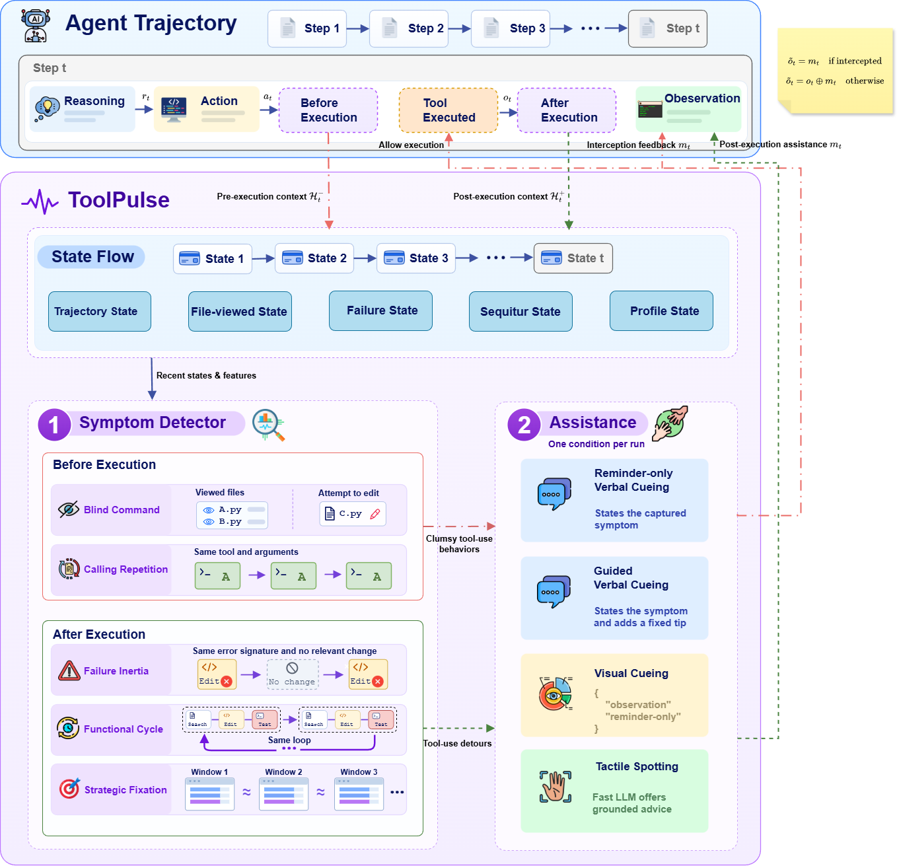
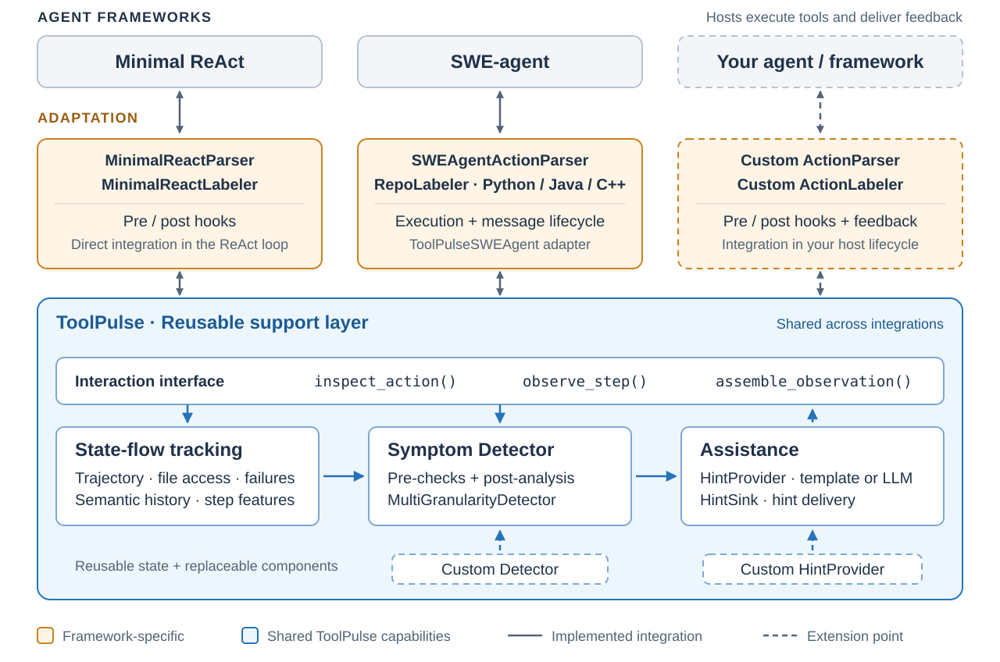

# ToolPulse

<p align="center">
  
</p>

[English](README.md) | [简体中文](README.zh-CN.md)

**面向任务型智能体、基于状态流追踪的在线工具使用辅助中间件。**

ToolPulse 为智能体的自主工具使用提供基础支持。它跨交互追踪执行上下文与工具使用的时序模式，在调用执行前检查拟议动作，在智能体继续行动前分析工具反馈。持续演化的状态帮助它结合智能体的工作节奏，识别笨拙的工具操作和工具使用中的绕路行为。

当需要介入时，ToolPulse 可以给出提醒、提供针对当前上下文的建议，或由宿主拦截依据不足的调用。它像举重时的保护者，在需要时给予提示或搭一把手，而推进任务的责任仍由智能体承担。



## 快速开始

需要 **Python 3.10+**。在仓库根目录执行：

```bash
python -m pip install -e .
python examples/minimal_react/run.py
```

这会运行一个完整的最小 ReAct 循环，包含两种在内存中执行的工具。安装依赖后，演示无需 API key、模型服务、网络访问、Docker 或 SWE-agent。

七个预设动作依次展示 Blind Command、Failure Inertia 和 Calling Repetition，以及修改后的成功检查。输出包含：

```text
Tool-use notice: You tried to edit note.txt using file before inspecting the file in the current task.
Tool-use notice: You received test_failure error again from check without taking an effective recovery action after the previous error.
Tool-use notice: You called check with exactly the same arguments in 3 consecutive steps.
...
Finished
```

决策使用预设顺序以便复现，不会根据提示改变；工具结果来自对内存文件的实际操作。完整说明见 [minimal ReAct 示例](examples/minimal_react/README.zh-CN.md)。

## How it works

### Symptom Detector

Symptom Detector 利用持续演化的执行状态，识别跨交互出现的工具使用症状。它在执行前检查拟议调用，在执行后分析工具反馈，结合动作轨迹、文件查看记录、失败记录与时序模式进行判断：

```text
智能体提出工具调用
  → 基于当前上下文执行 pre 检查
  → 宿主执行或拦截调用
  → 对已执行调用的反馈进行 post 分析
  → 将辅助信息加入智能体的下一轮输入
```

当前检测器识别五类症状：

| 症状 | 检测信号 |
|---|---|
| Blind Command | 在当前任务中尚未查看文件就尝试修改 |
| Calling Repetition | 连续使用相同动作和参数调用工具 |
| Failure Inertia | 缺少中间恢复信号的反复失败 |
| Functional Cycle | 语义动作序列反复出现 |
| Strategic Fixation | 连续交互窗口中的行为高度相似 |

框架提供动作语法与语义，ToolPulse 提供共享的状态追踪、检测和辅助信息生成能力。宿主控制工具执行，并将反馈交给智能体。

### Assistance

Assistance 将检测到的症状转化为智能体下一轮可读取的 hint。可以选择下列提示，也可以按任务与宿主框架实现自定义 `HintProvider`。

`HintProvider` 将症状检测与提示生成解耦，使同一种检测结果能够根据任务与执行上下文获得不同的辅助。这一设计允许使用者选择或替换 hint 的生成方式，复用已有检测器与宿主接入逻辑。

| Hint 选项 | 智能体收到的内容 | 配置方式 |
|---|---|---|
| 仅提醒提示 | 简短描述检测到的症状 | `TemplateHintProvider(hint_set_name="remind_only")` |
| 带引导的提示 | 症状描述与固定建议 | `TemplateHintProvider(hint_set_name="remind_and_guide")` |
| 结构化提示 | 分别包含 `observation` 和 `hint` 字段的 JSON 字符串 | `TemplateHintProvider(hint_set_name="different_message_type")` |
| 上下文相关提示 | 辅助语言模型根据任务、工具反馈与近期轨迹生成的建议 | 为 `LLMHintProvider` 配置提示集合与模型客户端 |

两个示例默认使用模板提示，不额外调用辅助模型。体验结构化反馈：

```bash
python examples/minimal_react/run.py --hint-set different_message_type
```

## 示例

| 示例 | 展示内容 | 运行条件 |
|---|---|---|
| [minimal ReAct](examples/minimal_react/README.zh-CN.md) | 可直接修改的循环、独立动作解析器与语义标签，以及明确的 pre/post 接入点 | 仅需 ToolPulse；决策采用预设顺序 |
| [SWE-agent](examples/swe_agent/README.zh-CN.md) | 通过可复用 adapter 接入已有智能体的执行与消息生命周期 | Python 3.11+、文档指定的官方 SWE-agent 版本；执行任务需要 Docker |

SWE-agent 示例默认使用交互式 `human` 模式，无需 API key。使用模型自动执行时，需要配置模型服务及其要求的凭据。`--check-config` 可以在不启动 Docker、不调用模型的情况下验证配置。安装与启动命令见该示例的 README。

## 接入新框架



*ToolPulse 为不同智能体框架提供共享的支持层。橙色标示与框架相关的动作解析、语义定义和宿主生命周期接入，蓝色标示可复用的状态追踪、症状检测与辅助能力。实线连接表示已实现的接入，虚线元素表示扩展点；自定义检测器和提示生成器通过同一套组件接口接入。*

新框架需要提供**动作解析器**与**语义解析器（labeler）**，包括语义标签表、工具使用类型、错误指纹，以及文件读写等相关上下文。minimal ReAct 的这些组件位于 `src/toolpulse/parsing/minimal_react.py` 和 `src/toolpulse/semantics/minimal_react/`。

在宿主循环中，执行前调用 `inspect_action()`，对每次已执行动作调用一次 `observe_step()`。用 `assemble_observation()` 将返回的提示与工具反馈合并，交给智能体的下一轮输入；开始新任务时重置会话。宿主可以根据 pre 检查事件选择拦截调用或提醒后继续执行。

这些适配复用 ToolPulse 的会话状态与支持组件。在 `ToolPulse(...)` 中传入自定义的 `detector`、`hint_provider` 或 `hint_sink`，即可通过 `Detector`、`HintProvider` 和 `HintSink` [组件协议](src/toolpulse/core/protocols.py)扩展检测与辅助能力，并沿用同一套宿主接入接口。

[minimal ReAct 示例](examples/minimal_react/README.zh-CN.md)完整展示了这些步骤，包括接入新框架所需的 parser、语义标签表与循环接入点。

## 仓库结构

```text
ToolPulse/
├── src/toolpulse/        # 可复用中间件与框架接入实现
│   ├── parsing/         # 框架动作解析器
│   ├── semantics/       # 语义标签表、语义解析与错误分类
│   ├── integrations/    # 已有智能体框架的适配器
│   └── ...              # 共享状态、检测器、提示与可选模型客户端
├── examples/
│   ├── minimal_react/   # 可直接修改的预设 ReAct 循环
│   └── swe_agent/       # 官方 SWE-agent 的配置与运行入口
├── tests/               # 单元、集成与兼容回归测试
├── assets/              # 项目 logo 与概念图
└── pyproject.toml       # 包元信息与依赖
```

框架的解析器和语义定义放在 `src`，示例提供使用这些组件的宿主循环或运行入口。两个示例均提供中英文 README。

## 实现范围与开发

检测采用启发式，触发提示后仍需结合上下文判断。当前实现包含一个多粒度检测器、最小 ReAct 语义体系，以及面向 Python、Java、C++ 仓库任务的语义体系。SWE-agent adapter 支持文档指定版本的 `DefaultAgent`。两个示例用于展示接入流程，不构成任务效果评测。

安装开发依赖并运行测试：

```bash
python -m pip install -e '.[dev]'
python -m pytest
```

未安装可选宿主时，需要 SWE-agent 的测试会跳过。

## 许可证

ToolPulse 采用 [MIT 许可证](LICENSE)。改编自上游的代码所涉及的版权声明与许可条款保留在[第三方声明](THIRD_PARTY_NOTICES.md)中。
